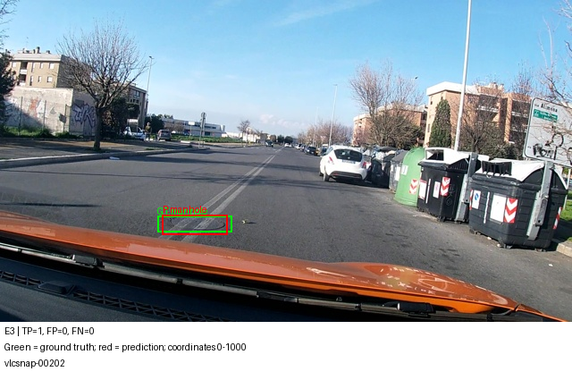
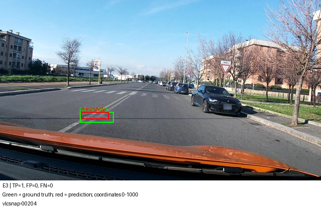
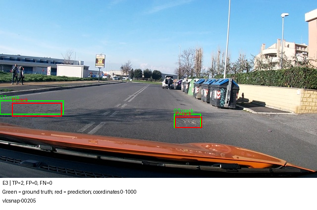
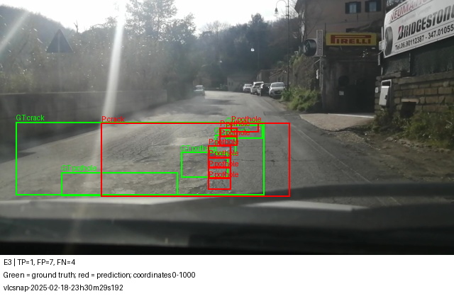
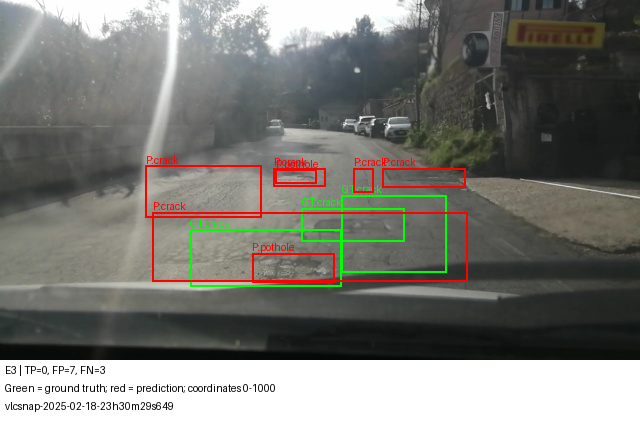
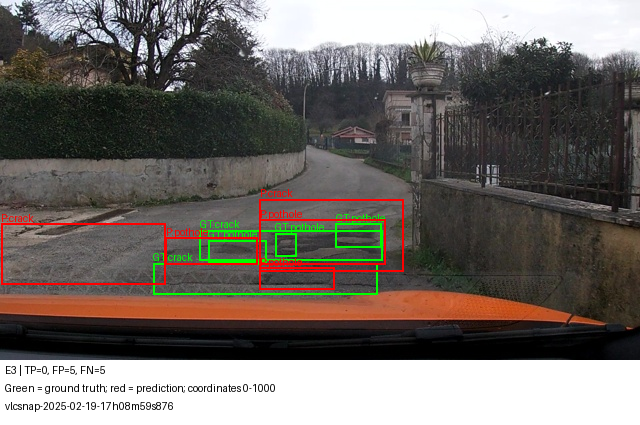

# Báo cáo Lab Day 10
Họ tên: Nguyễn Khánh Đô

dataset_version: d10-21e4070301

Kết quả từ notebook `ngkhdio/day10-qwen3-vl-retry` đã hoàn tất trên Kaggle. Sáu bộ raw prediction được tải về và chấm lại bằng scorer gốc, khớp micro F1, CI95, kết quả từng lớp và parse rate trong evidence. E3 được chọn bằng validation, không chọn bằng test. E5 chưa chạy.

Kết quả chính: E1 cải thiện F1 0,251106 so với zero-shot; E3 đạt F1 0,410256. Mở projector cải thiện rõ trong phép bootstrap hiện tại; lợi ích bổ sung của LoRA ViT so với E2 còn bất định khi bootstrap theo session.

## Bảng tổng hợp
| Mã | Setup | Tham số train | VRAM GiB | Phút | F1 | CI95 | FP/ảnh | pothole | crack | manhole |
|---|---|---:|---:|---:|---:|---|---:|---:|---:|---:|
| e0 | zero-shot | 0 | 0.000000 | 0.000000 | 0.021705 | [0.008941877794336812, 0.040310077519379844] | 0.176849 | 0.000000 | 0.028736 | 0.023392 |
| e1 | LoRA LLM | 33030144 | 5.062208 | 46.708347 | 0.272811 | [0.2380952380952381, 0.30917874396135264] | 1.138264 | 0.095745 | 0.212833 | 0.550388 |
| e2 | + full projector | 142135296 | 6.724412 | 47.488301 | 0.353818 | [0.31657355679702054, 0.3958135109419601] | 0.967846 | 0.207921 | 0.295798 | 0.584838 |
| e3 | + LoRA ViT | 148426752 | 6.861291 | 57.170399 | 0.410256 | [0.36742081447963804, 0.4514959202175884] | 1.016077 | 0.251046 | 0.340496 | 0.689895 |
| e4_data_size_0.1 | e3, 10% train | 148426752 | 6.744987 | 57.559881 | 0.278261 | [0.2427652733118971, 0.3122977346278317] | 1.627010 | 0.163009 | 0.216718 | 0.533333 |
| e4_data_size_1.0 | e3, 100% train (reuse) | 148426752 | 6.861291 | 57.170399 | 0.410256 | [0.36742081447963804, 0.4514959202175884] | 1.016077 | 0.251046 | 0.340496 | 0.689895 |

Số trong bảng làm tròn 6 chữ số; bằng chứng JSON giữ toàn bộ độ chính xác. E0 không huấn luyện nên ba cột tài nguyên huấn luyện bằng 0; thời gian inference ở report/diagnostics. VRAM dùng max_memory_allocated / 2**30 (GiB), không phải tổng reserved hoặc số hiển thị nvidia-smi.

### Câu 1 — Kiến trúc và các khối cập nhật
Số phần tử trọng số gốc đo trước LoRA (khôi phục shape logic của Params4bit): {"vision_backbone": 306242560, "projector": 109105152, "language_and_head": 4022468096}.
vision_backbone loại trừ projector để tránh đếm hai lần; language_and_head gồm embedding và lm_head.
E1 chỉ LoRA LLM; E2 thêm full visual.merger và deepstack_merger_list; E3 thêm LoRA attention/MLP của ViT, gồm cả attn.proj.
Số module khớp: {'e1': 252, 'e2': 252, 'e3': 348}.
Chênh lệch tham số train E2−E1: 109105152.

### Câu 2 — E0
parse_valid_rate=0.411576. Hai nhóm lỗi tự động thường gặp nhất: [('invalid_json', 183), ('missed_ground_truth', 124)].
Các nhóm có thể trùng trên cùng ảnh; unmatched_prediction không tự xác định được nguyên nhân là sai lớp hay lệch box.
Ví dụ ảnh vlcsnap-00200:
~~~text
[759, 634, 849, 690], [909, 786, 999, 822]
~~~
Ví dụ này không tuân thủ schema: trả các mảng tọa độ rời, thiếu object `label`/`bbox_2d` và thiếu một mảng JSON bao ngoài. Vì vậy parser từ chối toàn bộ output. Trong 311 ảnh, chỉ 128 output hợp lệ và 183 output lỗi; 124 ảnh thuộc nhóm output hợp lệ vẫn có GT bị bỏ sót. Hai nhóm lỗi được đếm riêng bởi bộ phân tích; không suy ra sai lớp hay lệch vị trí chỉ từ FP.

### Câu 3 — Thang 0–1000
Với cùng output E1, chấm đúng norm1000: F1=0.272811; cố tình chấm nhầm pixel: F1=0.000000.
Pixel được đổi bằng x/width*1000 và y/height*1000. Nhầm đơn vị làm box dịch và phóng khác nhau theo hai trục, nên mất ghép IoU≥0.5.
Đây là kiểm tra cách chấm trên cùng prediction, không phải thí nghiệm huấn luyện pixel của E4.
Kiểm tra YOLO→JSON→pixel trên sáu ảnh ở report/diagnostics/round_trip.json cho sai số cực đại lần lượt 0,28032; 0,32; 1,00008; 0,16; 0,32; 0,31968 pixel. Trường hợp 1,00008 pixel cho thấy không thể khẳng định mọi box đều sai số ≤0,32 pixel: quy tắc giữ box hợp lệ sát biên có thể dịch tọa độ hơn làm tròn thông thường. Sáu ảnh ground_truth cho phép kiểm tra trực quan phép chuyển đổi.
Thang chuẩn hóa giúp biểu diễn tương đối độc lập kích thước ảnh; lượng tử 1 đơn vị tương ứng 0.64 px ngang, 0.36 px dọc với ảnh này.

### Câu 4 — Mask loss
Audit thật: 220 token ảnh; 369 token tổng; 57 token được tính loss.
Prefix prompt đã được kiểm tra bằng tensor equality. Prompt, image tokens và padding mang nhãn −100; chỉ JSON assistant và im_end được giám sát.
Token giám sát giải mã:
~~~text
[{"label":"crack","bbox_2d":[583,583,895,897]},{"label":"crack","bbox_2d":[358,586,548,825]}]<|im_end|>
~~~
Nếu tính loss trên prompt/image placeholder, mô hình học dự đoán các token cấu trúc lặp lại và giảm trọng số tương đối của nhiệm vụ JSON.
Đây không phải loss tái tạo pixel ảnh. Mask nhãn cũng không cắt đường gradient qua đặc trưng ảnh: E3 vẫn học ViT từ loss câu trả lời.

### Câu 5 — Lượng tử hóa và projector
NF4 chỉ áp dụng cho LLM; visual và lm_head nằm trong skip_modules, có assertion không chứa Params4bit.
Projector full train cần trọng số floating-point có gradient; weight packed 4-bit không thể cập nhật trực tiếp như tham số dense thông thường.
Toàn bộ tham số train được giữ float32 (kể cả LoRA); forward dùng autocast fp16 và GradScaler. Điều này tránh lỗi unscale gradient fp16 và cải thiện độ ổn định cập nhật; float32 không bảo đảm hết mọi overflow.
Model lưu adapter và projector.pt riêng; inference nạp lại và kiểm tra tên/shape projector.

### Câu 6 — Split theo session
Số đo thực tế: {"train": {"images": 1422, "sessions": 13, "boxes": {"pothole": 1074, "crack": 1750, "manhole": 691}}, "val": {"images": 276, "sessions": 2, "boxes": {"pothole": 66, "crack": 470, "manhole": 103}}, "test": {"images": 311, "sessions": 3, "boxes": {"pothole": 121, "crack": 299, "manhole": 163}}}.
audit_data kiểm tra không giao session, không trùng image_id và đúng số box từng lớp.
Số nhãn nguồn có width hoặc height bằng 0 trên toàn bộ splits: 1; chi tiết ở report/diagnostics/zero_area_annotations.json.
Không xóa nhãn hoặc sửa splits. Khi serialize đáp án SFT, mở rộng trục suy biến thành 1 đơn vị trên thang 0–1000.
Nhãn suy biến duy nhất là crack trong ảnh train `vlcsnap-00058`, có YOLO height=0; target được mở thành bbox [637,786,641,787]. Scorer vẫn giữ GT gốc. GT diện tích 0 sẽ không thể ghép IoU≥0.5 nếu có trong tập được chấm, nhưng trường hợp quan sát ở đây thuộc train, không phải một FN không thể khắc phục trên test. Nó tạo nhiễu mục tiêu SFT.
Chia frame ngẫu nhiên có thể đưa các ảnh gần trùng vào train/test, khiến F1 đánh giá khả năng nhớ bối cảnh thay vì tổng quát hóa trên phiên mới.
Chưa chạy random split nên không gán một mức tăng F1 giả định.

### Câu 7 — E1/E2/E3
Setup chọn trước khi xem test: e3, theo micro F1 trên validation; xem report/selection.json.
Validation F1 lần lượt là E1=0,201537; E2=0,286758; E3=0,396290. Trên test, E2 hơn E1 0,081006 F1, tăng 1,662204 GiB VRAM và khoảng 0,78 phút train; cả paired CI theo ảnh và session đều dương. Trong ngân sách T4 của lần chạy này, mở projector là lựa chọn có lợi.

E3 hơn E2 0,056439 F1, thêm khoảng 0,136879 GiB và 9,68 phút (khoảng 20,4% thời gian train E2). Tuy nhiên paired CI theo session chứa 0. Vì vậy chọn E3 theo val là phù hợp, còn khẳng định LoRA ViT luôn tốt hơn E2 cần thêm session và seed. E2 vẫn là phương án tiết kiệm thời gian đáng cân nhắc.
- e2-e1: ΔF1=0.081006; paired CI95 theo ảnh=[0.04393712159084601, 0.12022396569617722]; theo session (3 nhóm)=[0.05069600913608441, 0.14657525935812654].
- e3-e1: ΔF1=0.137445; paired CI95 theo ảnh=[0.0960824597670738, 0.17652619533310115]; theo session (3 nhóm)=[0.08245243128964058, 0.20001133208680372].
- e3-e2: ΔF1=0.056439; paired CI95 theo ảnh=[0.015237293486267511, 0.09785018847386562]; theo session (3 nhóm)=[-0.013539651837524203, 0.06254167716313741].
- e4_data_size_1.0-e4_data_size_0.1: ΔF1=0.131996; paired CI95 theo ảnh=[0.08862555075373701, 0.1764524647887324]; theo session (3 nhóm)=[0.0378787878787879, 0.21534463223117573].
ΔF1 dương nghiêng về setup đứng trước dấu trừ. CI chứa 0 chưa đủ bằng chứng cải thiện. CI không chứa 0 chỉ hỗ trợ kết luận dưới cách lấy mẫu đã dùng; chưa đo biến thiên giữa các seed huấn luyện.

### Câu 8 — Độ bất định trên tập test
- e0: F1=0.021705, CI95=[0.008941877794336812, 0.040310077519379844], độ rộng=0.031368.
- e1: F1=0.272811, CI95=[0.2380952380952381, 0.30917874396135264], độ rộng=0.071084.
- e2: F1=0.353818, CI95=[0.31657355679702054, 0.3958135109419601], độ rộng=0.079240.
- e3: F1=0.410256, CI95=[0.36742081447963804, 0.4514959202175884], độ rộng=0.084075.
- e4_data_size_0.1: F1=0.278261, CI95=[0.2427652733118971, 0.3122977346278317], độ rộng=0.069532.
- e4_data_size_1.0: F1=0.410256, CI95=[0.36742081447963804, 0.4514959202175884], độ rộng=0.084075.
CI chính thức bootstrap theo ảnh, nhưng các frame trong cùng session phụ thuộc nhau. Vì vậy tôi bổ sung paired bootstrap theo session, lấy cùng mẫu cho cả hai mô hình.
Chỉ có ít session độc lập nên CI theo nhóm cũng có thể không ổn định. Không dùng việc hai CI riêng lẻ giao nhau làm phép kiểm định chênh lệch; dùng CI của ΔF1 ở Câu 7.
Các kết quả là một seed, không chứng minh thứ hạng đúng cho mọi lần train hay mọi tuyến đường.

### Câu 9 — Lỗi theo lớp
Trong setup e3 chọn bằng val, lớp có F1 thấp nhất trên test là pothole: 0.251046.
Trung vị diện tích box / diện tích ảnh trên test: {'pothole': 0.004192700868000001, 'crack': 0.019813205035, 'manhole': 0.006688347743}. Số mẫu train từng lớp ở Câu 6.
Pothole có 1.074 box train, nhiều hơn manhole (691) nhưng F1 thấp hơn nhiều (0,251046 so với 0,689895), nên số mẫu đơn thuần không giải thích được thứ hạng. Pothole có trung vị diện tích khoảng 0,419% ảnh, nhỏ hơn manhole (0,669%) và crack (1,981%). Sai lệch biên trên box nhỏ dễ làm mất điều kiện IoU.

Quan sát ảnh 4–5 thấy ánh chói, tương phản mặt đường thấp và nhiều box dự đoán chồng lấn. Ảnh 6 có nhiều vùng pothole/crack liền nhau; box đỏ phủ rộng hoặc lệch so với box xanh. Đây là bằng chứng trực quan về lỗi định vị và phân đoạn vùng hư hại; chưa đủ để tách riêng tác động của ánh sáng, hình dạng hay ngữ nghĩa lớp. Hai ảnh thành công đầu cùng một đoạn đường và các ảnh lỗi cũng có frame gần nhau, nên sáu ảnh minh họa không đại diện cho sáu tình huống độc lập.
Các ảnh dưới đây được chọn từ tối đa ba ảnh khớp hoàn toàn và ba ảnh lỗi nhiều nhất; nếu thiếu nhóm nào thì bổ sung ảnh khác, không bịa nhãn đúng/sai.

vlcsnap-00202: TP=1, FP=0, FN=0. Box manhole đỏ gần trùng box xanh ở phía trước xe; đúng lớp và đạt ngưỡng IoU.

vlcsnap-00204: TP=1, FP=0, FN=0. Một ảnh thành công tiếp theo trong cùng session; không coi đây là bằng chứng độc lập về tổng quát hóa.

vlcsnap-00205: TP=2, FP=0, FN=0. Hai vùng crack bên trái và gần giữa bên phải đều được ghép đúng; box vẫn có sai lệch biên nhưng đạt IoU≥0,5.

vlcsnap-2025-02-18-23h30m29s192: TP=1, FP=7, FN=4. Cảnh ngược sáng; nhiều pothole đỏ dồn vào một dải hẹp, box crack đỏ rộng và lệch so với GT. Chỉ một box ghép thành công.

vlcsnap-2025-02-18-23h30m29s649: TP=0, FP=7, FN=3. Các box crack đỏ rải rộng và khác biên GT; không box nào đạt ghép đúng lớp và IoU≥0,5. Output có box không đồng nghĩa đã phát hiện đúng.

vlcsnap-2025-02-19-17h08m59s876: TP=0, FP=5, FN=5. Nhiều hư hại sát nhau; box đỏ gộp hoặc lệch vùng xanh. Cần cải thiện định vị và phân biệt pothole/crack; chưa xác định được nguyên nhân riêng chỉ từ phép ghép.

### Câu 10 — E4
Chỉ đổi train_fraction 0.1 so với 1.0 trên setup e3; 10% chọn xác định theo seed, giữ nguyên LR, rank, alpha, batch, số bước, prompt và decoding.
100% tái sử dụng chính run gốc; report/ablation.json chứa cả hai cấu hình và kiểm tra chỉ một trường khác.
Giữ 300 optimizer steps nên 10% dữ liệu bị lặp nhiều hơn; kết luận là ảnh hưởng độ đa dạng dữ liệu dưới ngân sách bước cố định, không phải số epoch cố định.
10% gồm 142 ảnh, so với 1.422 ảnh của 100%. F1 tăng từ 0,278261 lên 0,410256 (Δ=0,131996); FP/ảnh giảm từ 1,627010 xuống 1,016077. Paired CI95 của Δ theo ảnh [0,088626; 0,176452] và session [0,037879; 0,215345] đều dương. Kết quả ủng hộ lợi ích của độ đa dạng dữ liệu với ngân sách 300 bước, nhưng chỉ có một lần chọn tập con và một seed; chưa suy rộng thành quy luật về mọi tỷ lệ dữ liệu.

## Tự kiểm tra các ngưỡng
E1 parse_valid_rate=0,990354 (308/311 ảnh), đạt ≥0,95.
F1(E1)−F1(E0)=0.251106; ≥0.10: True.
Hai ngưỡng E1 đều đạt từ raw output chưa chỉnh sửa. Không dùng test để chọn checkpoint hay sửa schema sau inference.

## Nhìn lại
Điểm cần phân biệt rõ nhất từ kết quả này là học schema và học định vị: E1 đã có 99,04% output hợp lệ nhưng F1 chỉ 0,272811. E3 cải thiện grounding, song các ảnh 4–6 cho thấy còn nhiều lỗi biên và box dư. Vì thế parse rate cao là điều kiện cần, chưa đủ để dùng model cho kiểm kê hư hại tự động.

Quá trình chạy gặp lỗi lượng tử hóa vision do prefix skip không đầy đủ và xung đột torchao/PEFT; notebook retry đã xử lý trước khi chạy đủ thí nghiệm. Một phiên resume riêng thất bại ở bước tìm dữ liệu khôi phục; kết quả nộp lấy từ phiên retry COMPLETE, không ghép số từ phiên lỗi. Các giới hạn còn lại cần giải quyết bằng validation và dữ liệu bổ sung, không sửa evidence test. Chưa chạy GRPO nên không nhận kết quả hoặc điểm thực nghiệm E5.
Giới hạn đo lường: một seed, test nhỏ và tương quan video, threshold IoU 0.5, không đánh giá tốc độ triển khai thời gian thực.
